<p align="center">
  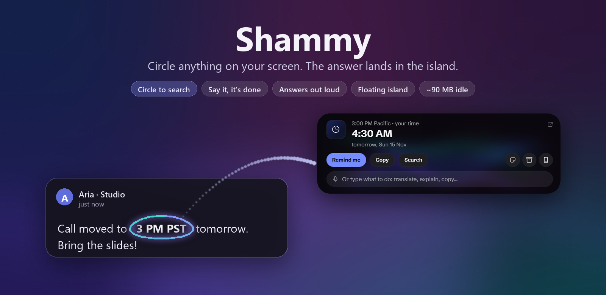
</p>

<p align="center">
  <a href="https://github.com/Roushan-2104/Shammy-Notch-For-Windows/releases/latest"></a>
  
  
  
  
  <a href="LICENSE"></a>
</p>

<p align="center">
  <b><a href="#install">Install</a></b> ·
  <b><a href="#circle-to-search">Circle to search</a></b> ·
  <a href="#the-floating-island">Island</a> ·
  <a href="#one-calm-screen">Open</a> ·
  <a href="#the-dial">Dial</a> ·
  <a href="#stage">Stage</a> ·
  <a href="#every-card">Cards</a> ·
  <a href="#everything-else">Everything else</a> ·
  <a href="#say-it-or-type-it">Commands</a> ·
  <a href="#privacy">Privacy</a>
</p>

---

**Circle anything on your screen and the answer lands right where you are.** A time in another zone becomes your time, a Japanese message becomes English, an error explains itself, a flight number tracks itself, a question you ask out loud is answered out loud. No new tab, no copy-paste, no paid AI.

Shammy turns the top of your Windows screen into a **floating island**: a pill of dark glass that glows softly with whatever is happening, opens into one calm screen when you need it, and blooms into a dial under your pointer when you hold the middle mouse button. It plays your music, keeps your calls, timers and meetings in view, reads your one-time codes, runs your laptop, and becomes a teleprompter under your camera when you present.

It's light (about **90 MB** while idle), it never needs a paid AI, and it stays out of your way.

<br>

<a name="circle-to-search"></a>
<p align="center"><picture><source media="(prefers-color-scheme: dark)" srcset="docs/images/type/circle-to-search-dark.svg">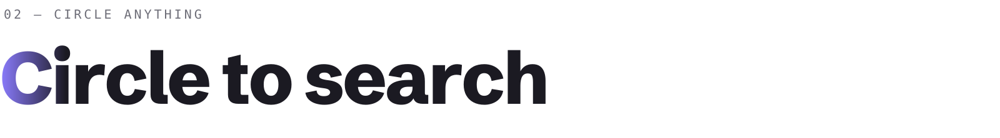</picture></p>

<p align="center">
  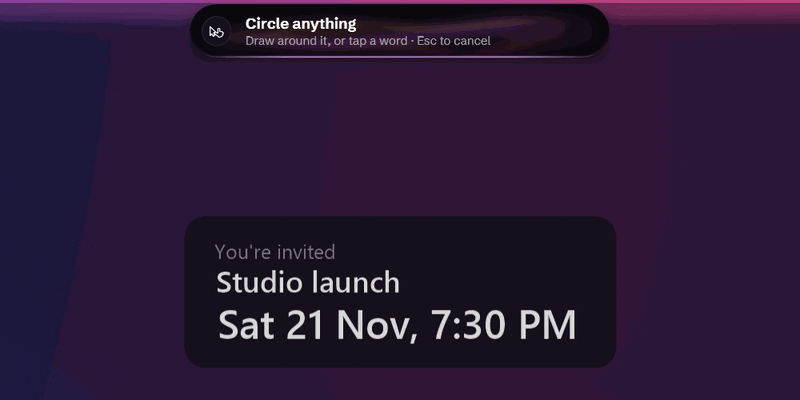
</p>

<p align="center"><b>Circle anything on your screen. The answer lands in the island, not in a new tab.</b></p>

Press <kbd>Copilot</kbd> (or hold <kbd>Right Ctrl</kbd>) and the screen holds still. Circle a word, a number, a paragraph, an error, a picture. Your circle is drawn in **liquid light**, and the answer leaves it as a drop and **flies into the island**. You never leave what you were doing.

<p align="center">
  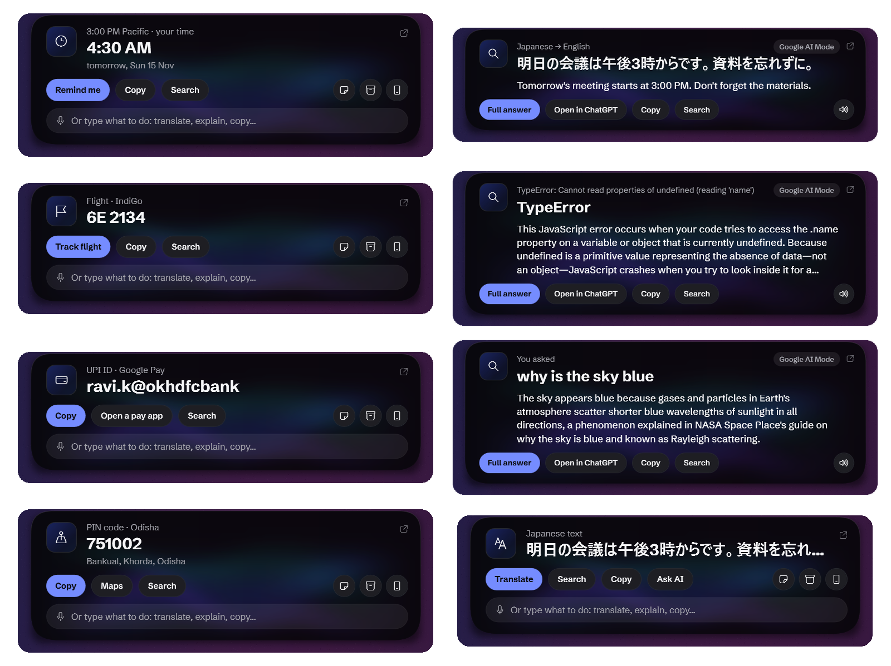
</p>

### 🎙️ Say what you want, while you circle

Talk as you draw, or type into the island afterwards. Shammy does exactly that, nothing more:

| Say or type | What happens |
|---|---|
| *"translate"* · *"in Hindi"* · *"matlab"* | The translation, right in the island |
| *"explain"* · *"kya hai"* · *"fix this"* | Google AI Mode explains it in two sentences |
| *"what time"* · *"convert"* | Your local time, rupees, metric |
| *"search"* · *"google it"* | The full results, as you'd expect |
| *"copy"* · *"track"* · *"call"* · *"remind me"* | Just that, in one go |
| *any question*, like *"is this vegan?"* | Asked about what you circled, answered in the island |

### ⚡ Plain things are answered instantly, on your PC

No Google, no waiting. Shammy reads it on your own PC and hands you the next step:

| You circle | The island shows |
|---|---|
| 🕒 `3 PM PST` | **4:30 AM**, your time, tomorrow · **Remind me** |
| ✈️ `6E 2134` | IndiGo flight · **Track flight** |
| 📦 a tracking number or a PNR | the courier or Indian Railways · **Track** |
| 💸 `name@okhdfcbank` | UPI ID, with its app · **Copy**, **Open a pay app** |
| 🏦 an IFSC code | the bank and the branch |
| 📮 a PIN code | the town and state · **Maps** |
| 🚗 `MH 12 AB 1234` | the state it's registered in |
| 🧮 `₹1,200 + 18% GST` | **₹1,416** |
| 📞 📧 🔗 📅 📍 🎨 | phone (**Call**, **WhatsApp**), email, link, date (**Remind me**, **Calendar**), address (**Maps**), colour (**hex**, **RGB**) |

### 💬 Everything else gets the right choices

- **Foreign text** (Japanese, Hindi, Spanish, French, Hinglish and more) is spotted on your PC and offers **Translate** first.
- **An error message or code** offers **Explain**: what went wrong and how to fix it, in plain words.
- **A name or a term** gets a short fact from Wikipedia.
- **A picture** gets Google Lens's own short answer first (what it is, in a line), with the full Lens results one tap away.
- **Any other text** offers **Ask AI**, **Search**, **Copy** and **Translate**, with **Search** always there.

### 🧠 Ask anything, hear the answer

Hold <kbd>Right Alt</kbd> and ask *"why is the sky blue"*, or tap it and type. A short answer from **Google AI Mode** appears in the island in a few seconds, with **Full answer**, **Open in ChatGPT**, **Copy** and **Search** under it. Ask out loud and **Shammy says the answer back** in whole sentences, in your Gnani voice. Start with *"search …"* when you'd rather have the results page.

A circled answer can be **sent anywhere** in one tap: **Notes**, the **Shelf**, your **phone**, or **Stage**. No paid AI, no account: it uses Google's own free AI Mode, Lens and Translate.

<br>

<a name="the-floating-island"></a>
<p align="center"><picture><source media="(prefers-color-scheme: dark)" srcset="docs/images/type/the-floating-island-dark.svg"></picture></p>

<p align="center">
  
</p>

The notch no longer hangs from the edge of your screen. It **floats** a few pixels below it, a pill of dark frosted glass.

- **Light like water.** Soft waves drift inside the glass in the colours of what you're playing, and dissolve before they reach the edges. When nothing is happening they hold still and cost nothing.
- **One liquid surface.** When there's something to press, a round button beads out of the island's end through a smooth, water-drop neck. It isn't stuck on; it flows out of the same glass.
- **Your song's colours, clearly.** While music plays under the Album palette, the waves come up in the cover's colours, and settle back when it stops.
- **A rim that breathes.** A thin line of light along the bottom edge tells you the state without opening anything: **red** while your mic is live, **green** before a meeting, **blue** in focus, your **song's colour** with music.
- **Fake glass, real calm.** The frosted look is a tiny pre-blurred copy of your wallpaper (about 26 KB), made once and remade only when your wallpaper changes. No live blur, no busy graphics card.

<p align="center">
  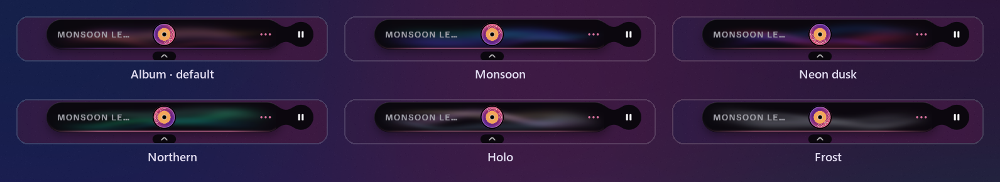
</p>

<p align="center"><sub><b>Six palettes.</b> <b>Album</b> (the default) takes its colours from the cover of what's playing. Pick another in Settings › Notch.</sub></p>

<br>

<a name="one-calm-screen"></a>
<p align="center"><picture><source media="(prefers-color-scheme: dark)" srcset="docs/images/type/one-calm-screen-dark.svg"></picture></p>

<p align="center">
  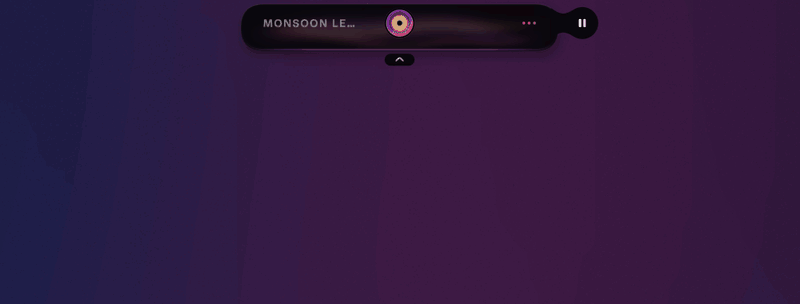
</p>

Rest the pointer on the island, or click it, and it opens into **one screen**. No row of tabs, nothing to learn:

- **One sentence** about right now: *Playing Monsoon Letters · Standup in 12 min*.
- **One big moment**: your song with its controls, your call and how long it's been, your focus time left, or your next meeting with *Join*.
- **Three numbers** set in light type: the weather, your battery, and whatever fits the moment.
- **Six tools that change with what you're doing**, the same ones the dial shows.

<table>
<tr>
<td width="50%">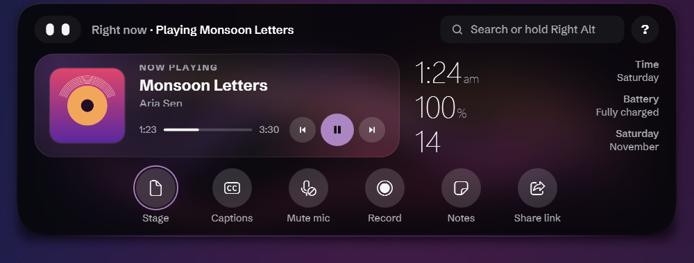<p align="center"><sub><b>In a call:</b> Stage, Captions, Mute mic, Record, Notes, Share link</sub></p></td>
<td width="50%">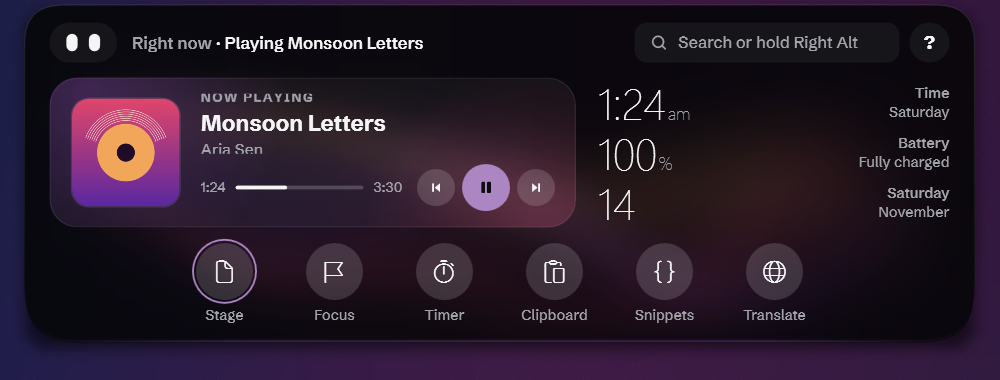<p align="center"><sub><b>Writing or coding:</b> Prompter, Focus, Timer, Clipboard, Snippets, Translate</sub></p></td>
</tr>
</table>

Everything else is one search, one voice command, one dial turn, or the **?** away.

<br>

<a name="the-dial"></a>
<p align="center"><picture><source media="(prefers-color-scheme: dark)" srcset="docs/images/type/the-dial-dark.svg"></picture></p>

<table>
<tr>
<td width="45%" align="center">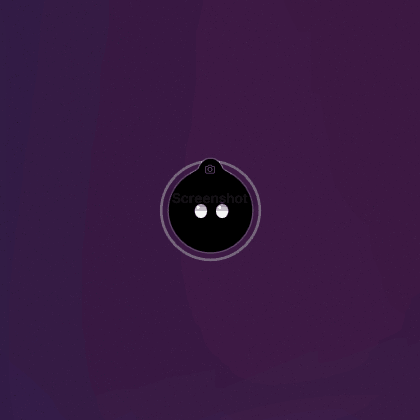</td>
<td width="55%" valign="middle">

**Hold the middle mouse button.** The dial blooms right where your pointer is, like a drop landing on water. Six tools bead out around it.

- **Scroll to turn it**, one click-stop at a time; the chosen tool swells and stays joined to the centre by a liquid neck.
- **Or just move** toward the tool you want.
- **Let go to choose.** Let go over the centre (or press <kbd>Esc</kbd>) to cancel.
- **It knows the moment.** In a call it offers Stage and captions; with music, the player; in an editor, your writing tools; otherwise, your own favourites.
- A quick middle click still reaches your apps, and the dial stays out of the way over fullscreen games and videos.

</td>
</tr>
</table>

<p align="center">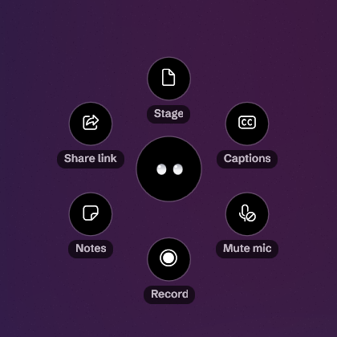</p>

<br>

<a name="stage"></a>
<p align="center"><picture><source media="(prefers-color-scheme: dark)" srcset="docs/images/type/stage-dark.svg"></picture></p>

<p align="center">
  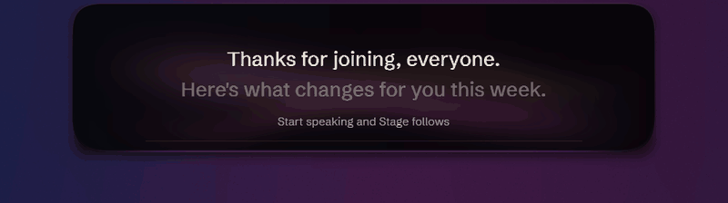
</p>

The island sits right next to your webcam, so it becomes your **studio** when you present or record.

- **Your script under the lens.** Three calm lines in warm off-white, set short so your eyes barely leave the camera, with one hairline for progress.
- **Paced by your voice.** It moves on while you speak and waits when you pause. No speech recognition, no extra memory.
- **A ring light your call never sees.** A warm glow around the screen's edge lights your face in a dark room, hidden from screen shares and recordings.
- **Their words, quietly.** The other person's latest line appears small under your script, from Windows' own Live Captions.
- **Mirror and Record** sit one click away and appear only on hover.

Say **"stage"**, **"stage from clipboard"**, or pick Stage on the dial.

<br>

<a name="every-card"></a>
<p align="center"><picture><source media="(prefers-color-scheme: dark)" srcset="docs/images/type/every-card-dark.svg"></picture></p>

<p align="center">
  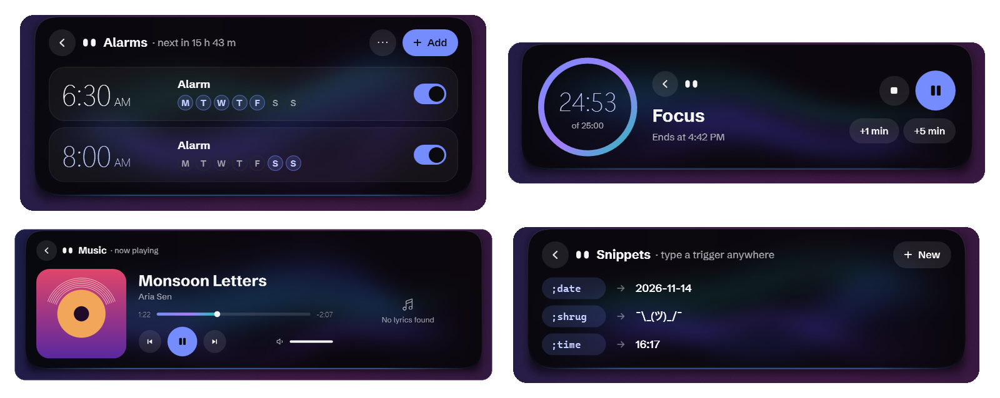
</p>

Open any card (Alarms, Timer, Clipboard, Notes, Weather, System, Health, Calendar, Laptop, Volume, Music, Settings and the rest) and **the island shapes itself around it**. A short list makes a short island; an empty card is one line. Every card has one header (Back, the pet's eyes, its name, a short status), light numbers and bold words on glass, and colour only from the island's palette, so under **Album** your cards take the colours of the song you're playing.

<br>

<a name="light-by-design"></a>
<p align="center"><picture><source media="(prefers-color-scheme: dark)" srcset="docs/images/type/light-by-design-dark.svg"></picture></p>

Shammy is built to be forgotten about:

| | Before | Now |
|---|---|---|
| Memory while idle (Task Manager) | several hundred MB | **about 90 MB** |
| Shammy's own memory | 839 MB | **about 120 MB** |
| Browser processes while idle | 6 | **0** (results open a browser only when they show) |
| Voice model in memory | always | **never**, unless you're offline and speak |
| Graphics work at rest | live blur and shadows | **none**: everything rests still |
| Installer | 133 MB | **104 MB** |

<br>

<a name="everything-else"></a>
<p align="center"><picture><source media="(prefers-color-scheme: dark)" srcset="docs/images/type/everything-else-dark.svg"></picture></p>

| | |
|---|---|
| 🗣️ **Talk to it** | Hold <kbd>Right Alt</kbd> and say it your way, in English or Hinglish: *"screenshot le lo"*, *"gaana band karo"*, *"battery kitni hai"*. Two things at once work too: *"take a screenshot and send it to my phone"*. Not sure what you meant? It offers **Did you mean** choices instead of guessing. |
| ⌨️ **Type anything** | Tap <kbd>Right Alt</kbd> for the palette: apps, files, settings, music and commands rank as you type. |
| ⭕ **Circle to search** | Circle anything and say or type what to do: times, flights, UPI IDs, PIN codes and more are answered on your PC; translations, explanations and questions come from Google AI Mode, in the island. [More](#circle-to-search) |
| 💻 **Your laptop, in one card** | Wi-Fi, Bluetooth, power mode, keep awake, mute mic, **Quiet** (pop-ups held for an hour), **night light**, lock, sleep, and restart or shut down (they ask first). Say *"turn off wifi"*, *"performance mode"* or *"quiet for an hour"*. |
| ⚙️ **Settings you can search** | Eleven tabs and a search box that finds any setting; the palette flips switches right in the list. |
| 🔢 **Codes at a glance** | A one-time code in a message shows big in the island with a **Copy** button. Copied privately (not in clipboard history), cleared after a minute, hidden while you share your screen, never logged. |
| 🌅 **Morning brief** | The first unlock of a morning shows the weather, meetings, reminders and a low battery in one line, said aloud with your Gnani key. *"Good morning"* asks again. |
| 🎯 **Focus in one click** | From the dial or the island. It pauses Windows' focus with you, and when it ends tells you what waited: *3 messages waited · WhatsApp, Gmail*. |
| 🩺 **Health** | How full your drives are, a careful cleanup (temporary files older than a week, the Recycle Bin, old downloads moved to the Recycle Bin, each asks first), and a daily check of battery wear, startup apps and waiting updates. |
| 🎵 **Music** | *"play …"* in YouTube Music or Spotify, synced lyrics, scroll over the island for volume, swipe to skip. |
| 🔔 **Notifications** | Other apps' notifications, calmly, with message text hidden while you share your screen. |
| ⏱️ **Timers, alarms, reminders** | Live countdowns, real alarms that ring through fullscreen, and reminders in plain words: *"remind me at 6pm to call mom"*. |
| 📅 **Calendar** | Your Google Calendar from its secret address (no sign-in), your next meeting, and *Join* five minutes before. |
| 📋 **Clipboard, shelf, snippets** | Clipboard history with search, a file shelf you drop onto, and text snippets that expand in any app. |
| 📱 **Send to phone** | A QR code sends files and links to your phone over your own Wi-Fi. |
| 🤖 **Claude Code** | Coding-agent sessions in the island, with Allow and Deny. |
| 🎥 **Record and caption** | Record your screen to MP4, and live captions for anything your PC plays (Windows' Live Captions). |
| 🐾 **Shammy the pet** | A pair of eyes, or a cat with ears and a purr, that reacts to what you're doing. |

<br>

<a name="install"></a>
<p align="center"><picture><source media="(prefers-color-scheme: dark)" srcset="docs/images/type/install-dark.svg"></picture></p>

1. Download **`Shammy-Setup.exe`** from the [latest release](https://github.com/Roushan-2104/Shammy-Notch-For-Windows/releases/latest) and run it.
   - It installs for your account only, with no admin prompt.
   - .NET is included.
2. On first run, Shammy asks once whether it should **start with Windows**. The welcome tour follows.

- **Updates are automatic.** Shammy downloads new versions in the background, usually just a few MB, and shows the new version in the island with a restart button. After an update, a small note tells you what's new.
- **No installer?** `Shammy-Portable.zip` runs from any folder and updates itself the same way.
- **Voice:** with your own Gnani key (Settings › Voice & search), voice commands are heard online, in English and Hinglish. Without a key or without internet, a small English model (about 148 MB, downloaded the first time it's needed) hears that one command on your PC and then frees itself.

<details>
<summary><b>Requirements and first-run notes</b></summary>

- **Windows:** 10 (2004+) or 11. **Live captions** need Windows 11 22H2 or newer.
- **WebView2 Runtime** for search results. It comes with Windows 11 and current Edge; if it's missing, the island links to Microsoft's installer.
- **SmartScreen:** the build isn't code-signed yet, so SmartScreen may ask you to confirm the first run.
- **Upgrading from 0.9 or older:** Shammy moves its old, larger voice models to the Recycle Bin once (about 1.2 GB), so you can still restore them.
- **Uninstall** from Settings › Apps. Your settings and data in `%LOCALAPPDATA%\Shammy` are kept.

</details>

<a name="keys"></a>
<p align="center"><picture><source media="(prefers-color-scheme: dark)" srcset="docs/images/type/keys-dark.svg"></picture></p>

| | Key | What happens |
|:-:|---|---|
| 🗣️ | **Hold** <kbd>Right Alt</kbd> | **Talk.** Say a command or ask a question; let go and it runs. |
| ⌨️ | **Tap** <kbd>Right Alt</kbd> | **Type.** The palette drops out of the island. |
| ⭕ | <kbd>Copilot</kbd>, or hold <kbd>Right Ctrl</kbd> | **Circle.** The screen freezes; circle anything to search it. |
| 🫧 | **Hold** the middle mouse button | **Dial.** It blooms at your pointer; scroll to turn, let go to choose. |

Something of yours under the island? Click the **small tab under it** and it slides away for a few seconds. Click the open island once and <kbd>Tab</kbd>, the arrow keys, <kbd>Enter</kbd> and <kbd>Esc</kbd> work in it.

> On layouts where Right Alt is AltGr (English India, German, French…), Right Alt on its own is the talk key, and AltGr + a key still types (₹, €, @). Right Ctrl only counts when held on its own, so Ctrl shortcuts are unaffected.

<a name="say-it-or-type-it"></a>
<p align="center"><picture><source media="(prefers-color-scheme: dark)" srcset="docs/images/type/say-it-or-type-it-dark.svg"></picture></p>

| Say or type | What happens |
|---|---|
| `play kaahe mose` · `kesariya bajao` · `play tum hi ho on spotify` · `pause` · `next` | Plays in YouTube Music (or Spotify) · media controls |
| `stage` · `stage from clipboard` · `close stage` | Your script under the camera |
| `turn off wifi` · `wifi band karo` · `bluetooth on` · `performance mode` · `best battery` · `night light on` · `quiet for an hour` | The Laptop card's switches, by voice |
| `health` · `clean up my pc` · `disk space` | The Health card |
| `good morning` · `morning brief` | Your morning brief |
| `timer 25m tea` · `stopwatch` · `pomodoro` · `focus 45m` | A live countdown in the island |
| `remind me at 6pm to call mom` · `set an alarm for 7 am` · `kal subah 7 baje ka alarm laga do` · `note: buy milk` | Reminders, alarms and notes |
| `5 ft in cm` · `100 usd to inr` · `1.2 lakh in dollars` · `5pm ist in pst` · `time in tokyo` | Instant answers |
| `translate good morning to hindi` | Google Translate, in the island |
| `why is the sky blue` · `capital of japan` · `search best pizza near me` | A short answer from Google AI Mode in the island (said aloud when you asked by voice) · *"search …"* opens the results |
| While circling: `translate` · `explain` · `what time` · `copy` · `track` | Done to what you circled ([more](#circle-to-search)) |
| `calendar` · `what's next` | Your next meeting · the Calendar card |
| `open spotify` · `open github.com` · `open downloads` | App, site or folder launcher |
| `record my screen` · `live captions` · `captions off` | Recording · captions for what your PC plays |
| `take a screenshot and send it to my phone` | Two things, one after the other |
| `help` · `what can you do` · `how do I record my screen` | The guide, with a finder that takes your own words |
| `volume 50` · `brightness to 70%` · `mute mic` · `clipboard` · `laptop` | Levels, the mic, the Clipboard and Laptop cards |

<a name="privacy"></a>
<p align="center"><picture><source media="(prefers-color-scheme: dark)" srcset="docs/images/type/privacy-dark.svg"></picture></p>

- **Your voice:** with your Gnani key, a command's recording goes to Gnani while you hold the talk key; the key is encrypted on your PC. Without a key or offline, it's heard on your PC by the small offline model. Text on screen is read with Windows' own OCR.
- **What leaves your PC:**
  - searches go to Google only when you ask; the island shows "Sent to Google" whenever an image goes to Lens;
  - a circled phone number, email, link, date, address, sum, colour, time zone, flight, tracking number, PNR, UPI ID or vehicle number is read on your PC and goes nowhere; a circled name or term (one to four words) is looked up on Wikipedia for its short fact, and only those words are sent;
  - a question, an "explain" or a translation goes to Google (AI Mode or Translate) only when you ask, with only those words; a picture goes to Lens only when you circle it; the answer is read from Google's page out of sight and shown in the island;
  - for an IFSC or PIN code, only the code is sent to a free public lookup (Razorpay's IFSC service, India Post) to show the branch or the town;
  - **Open in ChatGPT** opens chatgpt.com in your browser only when you tap it;
  - a spoken answer goes to Gnani to be voiced, only when you asked by voice and a key is saved;
  - "weather in &lt;city&gt;" sends only that city name to Open-Meteo (no account, no key);
  - the calendar is read only from Google, at the secret address you pasted.
- **Captions, recordings and Stage:** captions come from Windows' Live Captions on your PC; recordings go only to your Videos folder; Stage and its ring light are hidden from screen shares and recordings.
- **One-time codes:** copied privately (no clipboard history, no cloud clipboard), cleared after a minute, hidden while you share your screen, and never written to the log.
- **Sharing your screen:** while you share your whole screen or record it, message text, meeting titles, reminders, notes and clipboard text are hidden. A setting can hide message text all the time.
- **Camera:** the mirror's camera runs only while the mirror is open on screen.
- **Your data:** clipboard history, notes, snippets and your calendar's address are encrypted with Windows DPAPI under your account; unpinned clipboard items are forgotten after 24 hours.
- **Logs** never contain what you said, searched or copied, and are kept for 3 days.
- **Phone transfers** stay on your local network, behind a random one-time link; received programs are renamed `.blocked`.
- **Claude Code** talks to Shammy only on your own PC, through a local address with a random token.

<details>
<summary><b>Known limits</b></summary>

- **Google robot check.** On shared or mobile connections Google sometimes shows "I'm not a robot" in the results card. Tick it once and the browser profile remembers it.
- **Lens** uses the same upload endpoint as lens.google.com's own upload button. It isn't a public API, so it could change.
- **Brightness keys:** Windows' own brightness pop-up can't be suppressed, because the firmware handles those keys.
- **Notifications:** clicking one opens the app, not the exact chat.
- **Exclusive-fullscreen games** can draw over a timer or alarm that breaks through fullscreen; you still hear its chime.
- **The Copilot key** replaces Windows' Copilot/Search action while Shammy runs.

</details>

<a name="build"></a>
<p align="center"><picture><source media="(prefers-color-scheme: dark)" srcset="docs/images/type/build-dark.svg"></picture></p>

```bash
dotnet test tests/Shammy.Core.Tests
dotnet run --project src/Shammy.App
```

You need Windows 10 (2004+) or 11, the .NET 8 SDK, and the WebView2 Runtime.

<details>
<summary><b>Releasing an update</b></summary>

1. Bump `<Version>` in `Directory.Build.props`.
2. Commit and push.
3. Run:

```bash
powershell -File scripts/release.ps1 -Publish
```

The script builds a self-contained release, packages it with [Velopack](https://velopack.io) (with a small delta from the previous release), and uploads Setup, the portable zip and the update packages to a GitHub release using your `gh` login. Without `-Publish` it only builds into `artifacts/releases`.

</details>

<details>
<summary><b>How it's put together</b></summary>

```
src/Shammy.Core      pure logic, unit tested: springs, activity priority, parsers, the island's look and
                     palettes, the dial's maths and moments, Stage's pacing, health and cleanup rules
src/Shammy.App       WPF app
  Shell/             the floating island: state machine, springs, shape, fake glass, waves, rim light
  Views/             the pet, the open island's Now screen, cards, search bar, results
  Search/            hotkeys, screen freeze, OCR, microphone, online voice with an offline backup
  Modules/           self-contained features (Stage, the dial, Laptop, Health, music, calendar, focus,
                     codes, morning brief, clipboard, mirror, captions, launcher, snippets, …)
  Playback/          media sessions, audio visualizer
  SystemInfo/        volume, brightness, battery, Bluetooth, downloads
  Notifications/     other apps' notifications via the Windows listener
  Interop/           Win32: keyboard and mouse hooks, window styles, capture
tests/               over 3,700 xUnit tests for Shammy.Core
```

Each feature is a module in `src/Shammy.App/Modules/`; its README explains how to add your own.

</details>

## License

Third-party models and libraries are credited in [THIRD-PARTY-NOTICES.md](THIRD-PARTY-NOTICES.md).

[MIT](LICENSE) © Roushan
