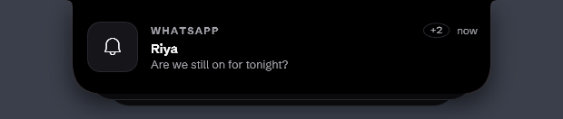
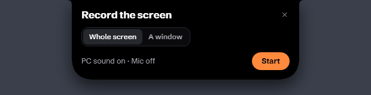
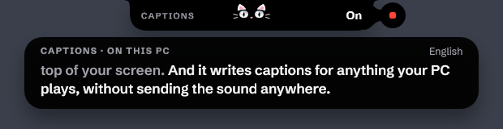
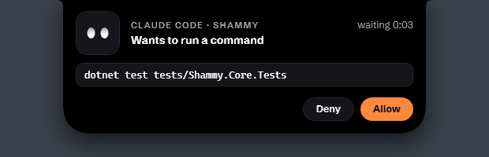
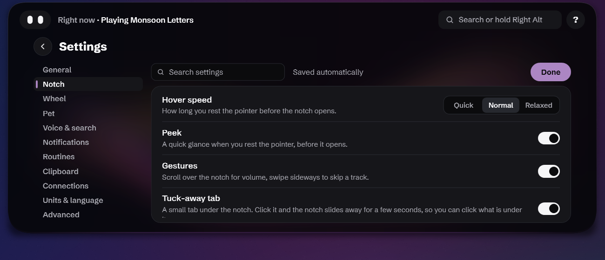
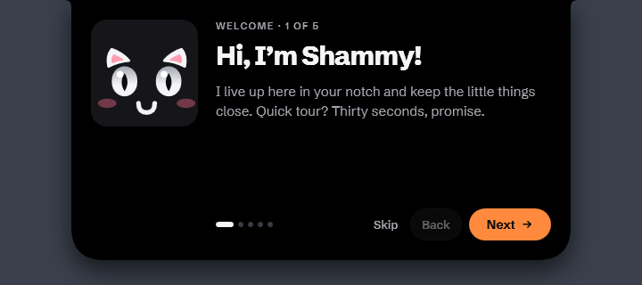

<p align="center">
  
</p>

<p align="center">
  <a href="https://github.com/Roushan-2104/Shammy-Notch-For-Windows/releases/latest"></a>
  
  
  
  <a href="LICENSE"></a>
</p>

<p align="center">
  <b><a href="#install">Install</a></b> ·
  <a href="#three-keys">Three keys</a> ·
  <a href="#a-day-with-shammy">Tour</a> ·
  <a href="#say-it-or-type-it">Commands</a> ·
  <a href="#privacy-by-default">Privacy</a> ·
  <a href="#build-it-yourself">Build</a>
</p>

---

Shammy turns the top-centre of your screen into a living notch, like the iPhone's Dynamic Island, made for Windows.

It answers questions with Google AI Mode, Web or Lens right inside the notch, lets you circle anything on screen to search it, and keeps your music, timers, calls, downloads and notifications in view. Shammy, a little cat (a pair of eyes with ears and whiskers), lives in the notch and changes to match whatever is going on, with a small action button beside the notch when there's something to press. Rest the pointer on it for a peek; click (or keep resting) and it opens into a rail of cards.

It runs on your PC with **no paid AI**:
- Google does the answering.
- Speech-to-text runs offline with Whisper, tuned for Indian English and the names of apps you have installed, with an optional Hinglish voice.
- Text recognition uses Windows' built-in OCR.

<!-- DEMO: replace this comment with the demo GIF, e.g. <p align="center"></p> -->
> 🎬 **Demo video coming soon.**

## Three keys

| | Key | What happens |
|:-:|---|---|
| 🗣️ | **Hold** <kbd>Right Alt</kbd> | **Talk.** Ask a question or say a command: *"play kesariya"*, *"5 ft in cm"*, *"timer 10 minutes"*. The screen stays live. |
| ⌨️ | **Tap** <kbd>Right Alt</kbd> | **Type.** The command palette drops out of the notch: apps, files, settings, music and commands rank live as you type. |
| ⭕ | <kbd>Copilot</kbd>, or hold <kbd>Right Ctrl</kbd> | **Circle.** The screen freezes. Circle, scribble or tap anything, speak if you like, then let go. |

Everything else is a **hover** away.

> On layouts where Right Alt is AltGr (English India, German, French…), Right Alt on its own is the talk key, and AltGr + a key still types (₹, €, @). Right Ctrl only counts when held on its own, so Ctrl shortcuts are unaffected.

## A day with Shammy

<table>
<tr>
<td width="50%" valign="top">

### ☕ It starts quiet
At rest the notch shows **Shammy the pet**, a small cat looking out of the dark: two eyes with ears, whiskers and a pink nose. It reacts to what's going on (music, a ping, a meeting about to start, a low battery, late nights), flicks an ear now and then, follows your pointer with its pupils and purrs when the pointer rests on it. Beside it sits a **glance** that rotates every few seconds: the time and date, your next meeting, the weather, the song, a running timer, a low battery, your ticker. Say *"pet off"* to keep just the glance. Rest the pointer on the notch and it **peeks**: the song (or the time) and the one thing that matters most, like *Join* for a meeting. A thin colour edge flashes briefly when something happens:
- the album colour for a new song;
- your accent colour for a notification or timer;
- green for charging;
- red for low battery.

</td>
<td width="50%"><br></td>
</tr>
<tr>
<td valign="top">

### 💬 Ask it anything
Tap <kbd>Right Alt</kbd> to type, or hold it to speak. Questions open Google **AI Mode** right inside the notch:
- switch to **Web** or **Lens** with one click;
- add **Reddit**, **Past week**, **No junk** or **Docs** filters, or just say them;
- save the whole scrolling page as one screenshot.

</td>
<td></td>
</tr>
<tr>
<td valign="top" colspan="2">

### 🧭 One palette for everything
Tap <kbd>Right Alt</kbd> and start typing. Results rank live, keyboard first (<kbd>↑</kbd> <kbd>↓</kbd> <kbd>Enter</kbd>), and learn from what you pick:
- **Commands first:** `timer 25m`, `2+2`, `remind me at 6pm`, `weather`, each with a preview of what will happen;
- **Apps:** `spot` opens Spotify; one misheard word is forgiven ("visual studio board");
- **Files** straight from the Windows Search index. <kbd>Ctrl</kbd>+<kbd>Enter</kbd> shows the file in its folder. Hidden and developer folders stay out of the way;
- **Settings, right there:** `brightness` gives a slider, `sound` gives volume, mute and your output devices, `bluetooth` gives an on/off switch, and words like `wifi` or `night light` open the right Settings page;
- **Music:** `play …` or `… bajao` plays on YouTube Music; pause, next and previous control what's playing;
- **Your own things:** notes, clipboard items, snippets and every view of the notch;
- **Google** is always the last row.

With nothing typed, it shows your recent picks and a *Try* row of ideas. Copied text and notes are never suggested on their own.

</td>
</tr>
<tr>
<td valign="top">

### ⚡ Instant answers
Sums, unit and currency conversions and time zones never leave your PC: no search, no wait. Exchange rates are free and refreshed daily. Copy an answer with one click, or save it as a note.

</td>
<td><br></td>
</tr>
<tr>
<td valign="top">

### ⭕ Circle to search
Press <kbd>Copilot</kbd> and the screen freezes. Circle a photo, a word or a paragraph:
- text goes to Google;
- images go to **Lens**, and a "Sent to Google" badge tells you when one leaves your PC;
- a circled **QR code** opens;
- a circled **price** converts to your currency.

</td>
<td><br><br></td>
</tr>
<tr>
<td valign="top">

### 🔔 Notifications, calmly
Other apps' notifications open right in the notch with a soft ping instead of Windows' chime, so you can read the message without touching anything:
- **hover** to keep one on screen;
- **click** to open the app;
- **right-click** to mute that app;
- **swipe** it sideways to send it away.

When more arrive they pile up underneath, and sending the top one away brings the next one up.

While you share your whole screen or record it, Shammy shows who a notification is from, but not what it says, and a message already on screen hides its text the moment sharing starts. Sharing just a tab or a window hides nothing, because the notch isn't in the picture, and neither does an ordinary call. Muted apps stay out of the Alerts list too.

</td>
<td><br></td>
</tr>
<tr>
<td valign="top">

### ⏱️ Live activities
Shammy stays in the middle of the notch and dresses for the occasion, with the details on either side:
- **a call:** a headset, the time on the call, and a mic button;
- **music:** the song's cover as a spinning record, the line being sung under it, and play/pause;
- **a timer:** a little stopwatch, the time left, and pause;
- **Claude Code:** how long it has been working, a nudge when it needs you, and "Done";
- **sharing or recording your screen,** a **download,** **charging** or your **earbuds' battery**;
- **an eye break:** every 20 minutes it closes its eyes with you for 20 seconds.

When there's something to press, a small **action circle** sits beside the notch, so you don't have to open anything. Pomodoro and focus sessions, volume and brightness, Bluetooth and updates live here too.

</td>
<td><br><br><br><br><br><br><br><br></td>
</tr>
<tr>
<td valign="top">

### 🗂️ Open it for the cards
Open the notch and you get a **rail of tiles** for what's going on now: music with its real album cover, weather, your calendar, timers, notes, battery. The notch fits itself to the tiles it has. The tile you're on grows and shows its controls, and the others dim back. Above them sit Shammy (home), a label for every part of Shammy and the search pill:
- Clipboard, Shelf, Notes, Alerts, System, Mirror, Calendar, Snippets, Settings, Timers, Music, Weather, Alarms;
- labels that don't fit are listed under **More**.

Click a tile or a label and it opens in place into a bigger view: synced lyrics, the week's forecast, today's timeline, your clipboard, notes you can type straight into. **Back** or <kbd>Esc</kbd> returns to the tiles.

</td>
<td><br><br></td>
</tr>
<tr>
<td valign="top">

### 🎥 Record, caption, approve
- **Record the screen:** say *"record my screen"* and pick the whole screen or one window. It saves an MP4 in Videos › Shammy, with PC sound on and the microphone off unless you change them, and the notch keeps itself out of the video.
- **Live captions:** say *"live captions"* and whatever your PC is playing is written in a strip under the notch, made offline by the same voice model.
- **Claude Code:** connect it once in Settings. Each session then shows in the notch, and when one needs your OK, **Allow** and **Deny** drop down so you can answer without switching windows.

</td>
<td><br><br></td>
</tr>
<tr>
<td valign="top">

### ⏰ Real alarms
Say *"wake me up at 6:30 every weekday"*, or add one yourself in the Alarms view. Pick the days, label it, and set how long a snooze lasts. An alarm rings until you stop or snooze it, swells up gently from quiet, and shows over fullscreen apps. You can turn off either of those last two.

</td>
<td></td>
</tr>
<tr>
<td valign="top">

### 🎛️ Make it yours
**Settings** opens right in the notch and saves as you go, in seven sections: General, Notch & pet, Voice, Notifications, Time & units, Clipboard & privacy, and Calendar. Choose a cat or just the eyes, the eye style and colour, the notch's size and accent colour, which screen it lives on, apps it should stay away in, lively or calm motion, how quickly the notch opens, your microphone, 12 or 24-hour time, and which features run at all.

New here? A **welcome tour** takes about thirty seconds, and that's where you can give the pet its own name. Say or type *"tour"* to see it again.

Not sure what Shammy can do? Click the **?** in the open notch, or say *"help"*. The **guide** lists every feature with what it does, the words that start it, a **Try it** button and its switch. Its finder takes everyday words (*"save what is on my screen"*), and it suggests things that fit the moment.

</td>
<td><br></td>
</tr>
<tr>
<td valign="top">

### 📎 The shelf and drop actions
Drag files onto the notch and pick where they land: **Shelf** parks them so you can drag them back out into any app later, **Send to phone**, **Compress** to a zip, or **Convert** PNG ⇄ JPG. Right-click a shelved file for **Send to phone**.

</td>
<td></td>
</tr>
<tr>
<td valign="top">

### 📱 Send to your phone
Like AirDrop, over your own Wi-Fi. Scan the QR code and the phone downloads the file in its browser, or uploads photos back into your PC's **Downloads** folder. No app, no cloud, no account.

</td>
<td></td>
</tr>
</table>

### And quietly, in the background
- 🎵 **Music:**
  - say *"play …"* to play it in YouTube Music, or *"… on spotify"*. It picks the original over remixes, lofi, covers and festival edits, unless you ask for one (*"kesariya lofi"*);
  - synced lyrics;
  - scroll over the notch for volume, swipe sideways to skip.
- 📋 **Clipboard:**
  - history of what you copy, with pinning and search; clearing it can be undone for a few seconds;
  - a screenshot catcher you can drag into any app, with Copy text, Search with Lens, Send to phone and Add to shelf;
  - save any copied text as a note;
  - Wi-Fi passwords from QR codes stay out of Windows' clipboard history.
- ✍️ **Snippets:** type `;date`, `;time`, `;shrug` or your own triggers in any app and they expand.
- 🚀 **Launcher:** *"open spotify"*, *"open github.com"*, *"open downloads"*.
- 📅 **Calendar:** paste your Google Calendar's secret iCal address once (no sign-in): the week and your next meeting on a card, today's timeline, a glance, and a *Join* pill five minutes before a call. Say *"remind me 5 minutes before standup"* for a meeting on your calendar.
- 🪞 **Mirror:** a quick look in your webcam before a call. The camera runs only while the mirror is open on screen.
- 🌤️ **Ambient:** weather, and a cricket, stocks or crypto ticker in the resting glance.
- 🖥️ **System:**
  - a CPU, memory and battery card, with your Bluetooth headsets' battery;
  - alerts when an app hogs the CPU or the battery drains fast, and when your earbuds run low.
- 🎚️ **Volume mixer:** a slider for each app that is making sound.
- ⚡ **Quick actions:** keep awake, lock, sleep, mute and more in one card.
- 📜 **Teleprompter:** your script scrolls right under the camera, and stays out of screen shares and recordings.
- 👀 **Nudges:** an eye break every 20 minutes, and water reminders if you turn them on.
- 🏏 **Live cricket:** the score in the notch while India is playing.
- 🗣️ **Online voice (optional):** with your own Gnani key, Shammy says timers, alarms and reminders aloud and can transcribe Hinglish online. Off until you add a key.
- 🤫 **Quiet mode:** the notch keeps itself quiet during a calendar meeting and a focus session.
- 🙈 **Fullscreen:** Shammy hides itself for fullscreen games, videos and presentations, and never covers a top taskbar. Only a finished timer or a due alarm or reminder shows over them, without taking focus.

## Install

1. Download **`Shammy-Setup.exe`** from the [latest release](https://github.com/Roushan-2104/Shammy-Notch-For-Windows/releases/latest) and run it.
   - It installs for your account only, with no admin prompt.
   - .NET is included.
2. On first run, Shammy asks once whether it should **start with Windows**. You can change this later in the tray menu. The welcome tour follows.

- **Updates are automatic.** Shammy downloads new versions in the background, usually just a few MB, and the notch shows the new version with a restart button beside it. If you ignore it, the update installs when Shammy next quits. After an update, a small note tells you what's new.
- **No installer?** `Shammy-Portable.zip` runs from any folder and updates itself the same way.
- **First launch:** Shammy downloads a small offline voice model (~148 MB) so you can talk within a minute. Typing and circling work meanwhile. It then checks your PC once and quietly fetches a sharper model in the background: about 574 MB on a PC with a usable graphics card, or 488 MB otherwise. The notch says *Voice upgraded* when it switches.
- **Hinglish voice (optional):** on a PC with a graphics card, tick *Hinglish voice (Hindi + English)* in the tray menu to switch to a model that understands Hindi mixed with English, like "kal subah 7 baje ka alarm laga do" (a one-time 574 MB download). It writes Hindi in Latin letters, and anything it isn't sure about is checked against the regular English model. It's off by default, and greyed out on PCs that run voice on the processor, where it would be too slow.

<details>
<summary><b>Requirements and first-run notes</b></summary>

- **Windows:** 10 (2004+) or 11.
- **WebView2 Runtime** for search results. It comes with Windows 11 and current Edge; if it's missing, the notch links to Microsoft's installer.
- **SmartScreen:** the build isn't code-signed yet, so SmartScreen may ask you to confirm the first run.
- **To hear only Shammy's ping,** turn off *Allow notifications to play sounds* in Settings › System › Notifications. The tray menu has a shortcut to that page.
- **Uninstall** from Settings › Apps. Your settings and data in `%LOCALAPPDATA%\Shammy` are kept.

</details>

## Say it or type it

| Say or type | What happens |
|---|---|
| `play kaahe mose` · `kesariya bajao` · `play tum hi ho on spotify` · `pause` · `next` | Plays in YouTube Music (or Spotify) · media controls. Hindi song names are checked against your listening history and a built-in list |
| `lyrics` | Synced lyrics, in the Music card |
| `timer 25m tea` · `stopwatch` · `pomodoro` · `focus 45m` | A live countdown in the notch |
| `remind me at 6pm to call mom` · `set an alarm for 7 am` · `kal subah 7 baje ka alarm laga do` · `parso subah 9 baje yaad dilana` · `note: buy milk` | A reminder card when it's due · the Notes card |
| `wake me up at 6:30 every weekday` · `alarms` · `snooze` | A repeating alarm · the Alarms view · Snoozes one that's ringing |
| `5 ft in cm` · `100 usd to inr` · `1.2 lakh in dollars` · `10 lakh + 5 lakh` · `5pm ist in pst` · `time in tokyo` | Instant answers (the palette shows the converted amount as you type) |
| `translate good morning to hindi` | Google Translate, in the notch |
| `calendar` · `my meetings` · `what's next` | Your next meeting · the Calendar card |
| `mirror` · `how do I look` · `open camera` | The Mirror card |
| `open spotify` · `open vs code` · `open google crome` · `open github.com` · `open downloads` | App, site or folder launcher (nicknames and one typo per word are fine) |
| `snippet ;sig Best, Roushan` · `snippets` | Text expansion in any app |
| `weather` · `weather in mumbai tomorrow` · `pune ka mausam` · `ticker cricket` · `ticker stocks RELIANCE.NS` · `pet on` | Weather card · ticker glance · Shammy's eyes on or off |
| `record my screen` · `stop recording` | The recording card · stops and saves the MP4 |
| `live captions` · `captions off` | Captions for whatever the PC is playing |
| `volume mixer` · `quick actions` · `teleprompter` · `teleprompter from clipboard` | The mixer · the quick actions card · your script under the camera |
| `help` · `features` · `what can you do` · `how do I record my screen` | The guide: everything Shammy does, with a finder that takes your own words |
| `tour` | The welcome tour |
| `volume 50` · `brightness to 70%` · `volume up` · `mute` | Sets the level directly |
| `mute mic` · `cpu` · `clipboard` · `clear clipboard` · `send to phone` · `take a screenshot` | Mic toggle · System card · Clipboard card · Clears it (with Undo) · QR transfer · Screenshot |
| *"…only from Reddit"*, *"…from the past week"*, *"…no junk"*, *"…from the docs"* | Search filters, spoken |

## Privacy by default

- **Voice and on-screen text:**
  - your voice is transcribed offline, on your PC;
  - text on screen is read with Windows' own OCR.
- **What leaves your PC:**
  - searches go to Google only when you ask;
  - "weather in <city>" sends only that city name to Open-Meteo's free geocoder and forecast (no account, no key);
  - the calendar is read only from Google, at the secret address you pasted;
  - the notch shows a "Sent to Google" badge whenever an image is uploaded to Lens;
  - online voice is off unless you add your own Gnani key. With it on, the words Shammy speaks (and your recording, if you turn on Hinglish listening online) go to Gnani. The key is encrypted on your PC.
- **Captions, recordings and the teleprompter:** captions are made on your PC from the sound it is playing; recordings go only to your Videos folder; the teleprompter is hidden from screen shares and recordings.
- **Claude Code:** Shammy and Claude Code talk only on your own PC, through a local address with a random token. Connecting adds a few lines to Claude Code's settings file and keeps a backup; Disconnect takes them out again.
- **The results browser:** it can only open web pages, so pages can't launch apps or files.
- **Sharing your screen:** while you share your whole screen or record it, message text is hidden in pop-ups and in the Alerts list, and so are meeting titles, reminders, notes and clipboard text. A normal call, or sharing a single tab or window, doesn't hide anything. It all comes back when sharing ends. A setting can hide message text all the time.
- **Camera:** the mirror's camera is on only while the mirror is open on screen, and stops when it closes or the PC locks.
- **Your data:**
  - clipboard history, notes, snippets, your calendar's address and the song titles voice remembers are encrypted with Windows DPAPI under your account. Song memory can be cleared or turned off from the tray;
  - unpinned clipboard items are forgotten after 24 hours.
- **Logs:** they never contain what you said, searched or copied, and are kept for 3 days.
- **Phone transfers:**
  - local network only, behind a random one-time link;
  - received programs are renamed `.blocked`;
  - every received file is marked as downloaded from the internet.
- **Downloads and builds:**
  - the voice model download is pinned and checked against its SHA-256;
  - release builds contain no paths from the build machine.

<details>
<summary><b>Known limits</b></summary>

- **Google robot check.** On shared or mobile connections Google sometimes shows "I'm not a robot" in the results card. Tick it once and the browser profile remembers it.
- **Lens** uses the same upload endpoint as lens.google.com's own upload button. It isn't a public API, so it could change.
- **Brightness keys:** Shammy shows its HUD, but Windows' own brightness pop-up can't be suppressed, because the firmware handles those keys.
- **Notifications** are read when Windows' notification store changes. Clicking one opens the app, not the exact chat: Windows doesn't let other apps trigger a toast's own buttons.
- **Exclusive-fullscreen games** (not borderless or windowed) can draw over a timer or alarm that breaks through fullscreen; you still hear its chime.
- **Spotting a screen share:** Shammy recognises it from Windows' own signals and from the sharing bar Chrome, Edge, Zoom and Teams show. An app that shows neither isn't noticed, so nothing gets hidden.
- **The Copilot key** replaces Windows' Copilot/Search action while Shammy runs.
- **First launch** shows the notch about 3 s after start (WPF's one-time theme load).

</details>

## Build it yourself

```bash
dotnet test tests/Shammy.Core.Tests
dotnet run --project src/Shammy.App
```

You need Windows 10 (2004+) or 11, the .NET 8 SDK, and the WebView2 Runtime.

<details>
<summary><b>Releasing an update</b></summary>

1. Bump `<Version>` in `Directory.Build.props`.
2. Commit and push.
3. Run:

```bash
powershell -File scripts/release.ps1 -Publish
```

The script:
- builds a self-contained release;
- packages it with [Velopack](https://velopack.io), including a small delta from the previous release;
- uploads Setup, the portable zip and the update packages to a GitHub release using your `gh` login.

Without `-Publish` it only builds into `artifacts/releases`, so you can try it first.

</details>

<details>
<summary><b>How it's put together</b></summary>

```
src/Shammy.Core      pure logic, unit tested: springs, activity priority, parsers (time, money, units,
                   reminders, snippets, music), calculator, selection analysis, phone-transfer server
src/Shammy.App       WPF app
  Shell/           the notch window: state machine, spring animation, shape, colour edge
  Views/           resting pet and glance, peek, the pet's live activities, the open notch's tiles, search bar, results
  Search/          hotkeys, screen freeze, OCR, microphone, Whisper
  Modules/         self-contained features (music, calendar, productivity, clipboard, mirror, launcher,
                   snippets, ambient, meeting/system, phone send, drop actions, screenshots, selection tools)
  Playback/        media sessions, audio visualizer
  SystemInfo/      volume, brightness, battery, Bluetooth, downloads
  Notifications/   other apps' notifications via the Windows listener
  Interop/         Win32: keyboard hook, window styles, capture
tests/             over 1,000 xUnit tests for Shammy.Core
```

Each feature is a module in `src/Shammy.App/Modules/`; its README explains how to add your own.

</details>

## License

Third-party models and libraries are credited in [THIRD-PARTY-NOTICES.md](THIRD-PARTY-NOTICES.md).

[MIT](LICENSE) © Roushan
