<p align="center">
  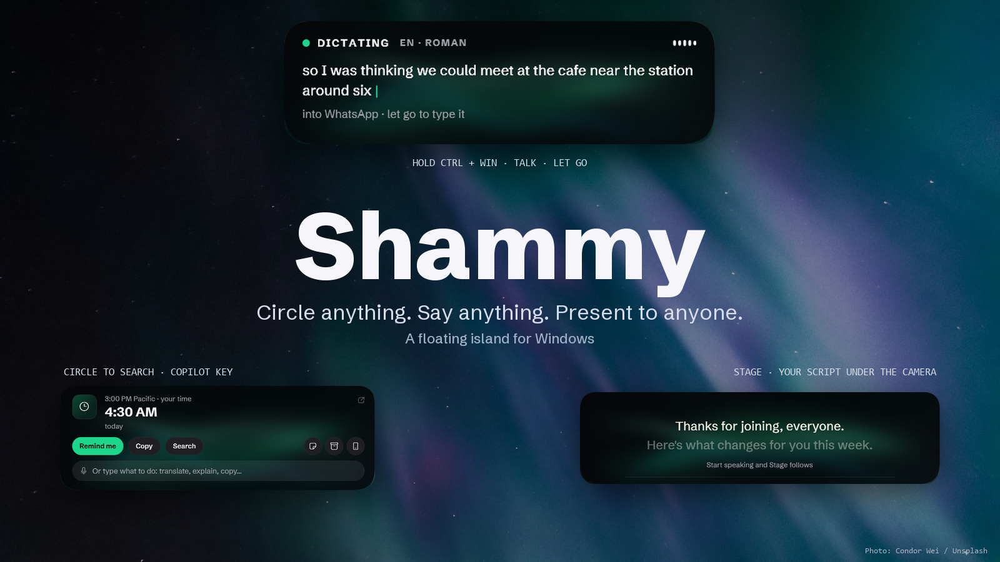
</p>

<p align="center">
  <a href="https://github.com/Roushan-2104/Shammy-Notch-For-Windows/releases/latest"></a>
  
  
  
  
  <a href="LICENSE"></a>
</p>

<p align="center">
  <b><a href="#install">Install</a></b> ·
  <b><a href="#circle-to-search">Circle to search</a></b> ·
  <b><a href="#dictation">Dictation</a></b> ·
  <b><a href="#stage">Stage</a></b> ·
  <a href="#hover">Hover</a> ·
  <a href="#the-floating-island">Island</a> ·
  <a href="#the-dial">Dial</a> ·
  <a href="#your-phone">Your phone</a> ·
  <a href="#everything-else">Everything else</a> ·
  <a href="#say-it-or-type-it">Commands</a> ·
  <a href="#privacy">Privacy</a>
</p>

---

<h3 align="center">Circle anything. Say anything. Present to anyone.<br>From the top of your Windows screen.</h3>

Shammy turns the top of your screen into a **floating island**, a pill of dark glass that glows softly with whatever is happening. Three things it does that nothing else on Windows does:

| | |
|:-:|---|
| ⭕ **[Circle to search](#circle-to-search)** | Circle anything on screen. A time becomes your time, Japanese becomes English, an error explains itself, a question is answered out loud. The answer lands in the island, not in a new tab. |
| 🎙️ **[Dictation](#dictation)** | Hold <kbd>Ctrl</kbd> + <kbd>Win</kbd> in any app and talk. Your words appear live in the island, and when you let go they're tidied and typed where your cursor is. English, Hinglish, or Hindi in Devanagari. |
| 🎥 **[Stage](#stage)** | Your script right under the camera, paced by your voice, with a ring light your call never sees and the other person's words, quietly. |

And it plays your music, keeps your calls, timers and meetings in view, reads your one-time codes and runs your laptop, in about **90 MB**, with no paid AI.

<br>

<a name="circle-to-search"></a>
<p align="center"><picture><source media="(prefers-color-scheme: dark)" srcset="docs/images/type/circle-to-search-dark.svg">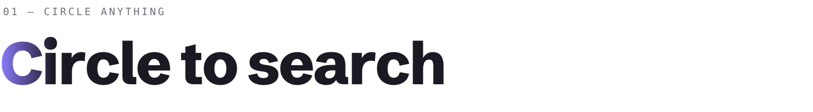</picture></p>

<p align="center">
  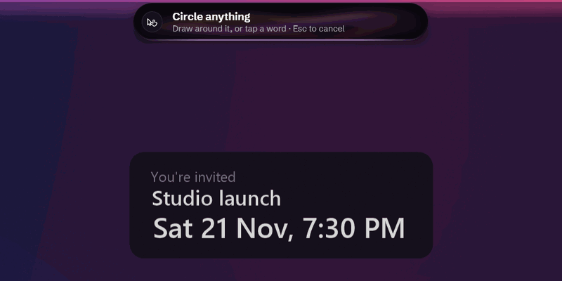
</p>

<p align="center"><b>Circle anything on your screen. The answer lands in the island, not in a new tab.</b></p>

Press <kbd>Copilot</kbd> (or hold <kbd>Right Ctrl</kbd>) and the screen holds still. Circle a word, a number, a paragraph, an error, a picture. Your circle is drawn in **liquid light**, and the answer leaves it as a drop and **flies into the island**. You never leave what you were doing.

<p align="center">
  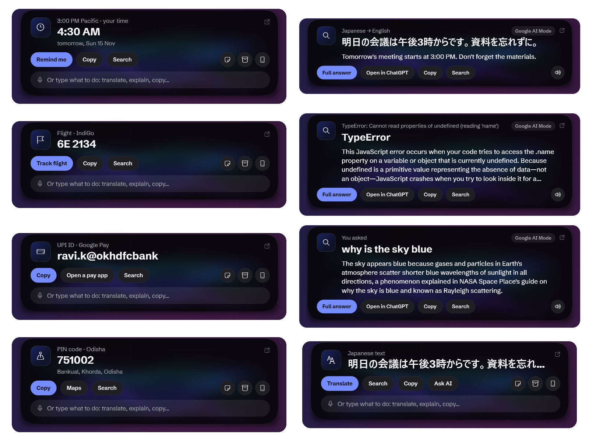
</p>

#### Say what you want, while you circle

Talk as you draw, or type into the island afterwards. Shammy does exactly that, nothing more:

| Say or type | What happens |
|---|---|
| *"translate"* · *"in Hindi"* · *"matlab"* | The translation, right in the island |
| *"explain"* · *"kya hai"* · *"fix this"* | Google AI Mode explains it in two sentences |
| *"what time"* · *"convert"* | Your local time, rupees, metric |
| *"search"* · *"google it"* | The full results, as you'd expect |
| *"copy"* · *"track"* · *"call"* · *"remind me"* | Just that, in one go |
| *any question*, like *"is this vegan?"* | Asked about what you circled, answered in the island |

#### Plain things are answered instantly, on your PC

| You circle | The island shows |
|---|---|
| 🕒 `3 PM PST` | **4:30 AM**, your time · **Remind me** |
| ✈️ `6E 2134` | IndiGo flight · **Track flight** |
| 🛒 a product | who sells it cheapest |
| 📦 a tracking number or a PNR | the courier or Indian Railways · **Track** |
| 💸 `name@okhdfcbank` | UPI ID, with its app · **Copy**, **Open a pay app** |
| 🏦 📮 🚗 | an IFSC code's bank and branch · a PIN code's town · a vehicle number's state |
| 🧮 `₹1,200 + 18% GST` | **₹1,416** |
| 📞 📧 🔗 📅 📍 🎨 | phone (**Call**, **WhatsApp**), email, link, date (**Remind me**, **Calendar**), address (**Maps**), colour (**hex**, **RGB**) |

Everything else gets the right choices: **foreign text** offers **Translate**, **an error** offers **Explain**, **a name or a term** gets a short fact from Wikipedia, and **a picture** gets Google Lens's own short answer first. Your circles are **remembered**, so you can find one later in your own words. Drag any answer out into another app, or send it to **Notes**, the **Shelf**, your **phone** or **Stage** in one tap.

Hold <kbd>Right Alt</kbd> and ask *"why is the sky blue"*: a short answer from **Google AI Mode** appears in the island in a few seconds, and **Shammy says it back** in whole sentences. No paid AI, no account.

<br>

<a name="dictation"></a>
<p align="center"><picture><source media="(prefers-color-scheme: dark)" srcset="docs/images/type/dictation-dark.svg"></picture></p>

<p align="center">
  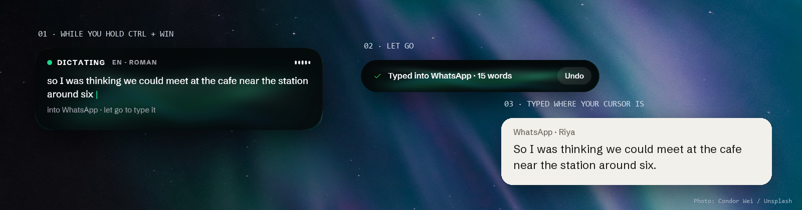
</p>

<p align="center"><b>Hold <kbd>Ctrl</kbd> + <kbd>Win</kbd>, talk, let go. It's typed where your cursor is.</b></p>

WhatsApp, Gmail, VS Code, a prompt to Claude: whatever has the cursor. While you talk, your words fill in **live in the island** with a small level meter beside them. Let go and they're typed in, and **"✓ Typed into WhatsApp · 15 words"** appears with an **Undo** button.

- **Your words, tidied.** Light clean-up adds punctuation and capitals, drops *um*, *uh* and *hmm*, and says a word you stumbled on once (*"I I think"* → *"I think"*). It never rewords anything. Turn it off to get exactly what was heard.
- **English, Hinglish, or Hindi.** Hinglish is typed in Roman letters, as you'd text it. Say ***"in Hindi"*** or ***"Hindi mein"*** first or last and that dictation is typed in Devanagari; the trigger words aren't typed.
- **Your clipboard stays yours.** The words are pasted through a private copy that never enters clipboard history, and what you had copied is put back straight after.
- **Careful by default.** Dictation is off in password boxes, and with no internet it says so with a **Try again** button; nothing is kept either way.
- **Pick your key** in Settings › Voice & search: **Hold Ctrl + Win** (the default), **Right Alt (smart)**, which dictates in text boxes and stays the voice-command key everywhere else, **Double-tap Right Alt** to start and tap once to stop, or **Off**.

Dictation uses your own Gnani key (the same one as online voice commands).

<br>

<a name="stage"></a>
<p align="center"><picture><source media="(prefers-color-scheme: dark)" srcset="docs/images/type/stage-dark.svg"></picture></p>

<p align="center">
  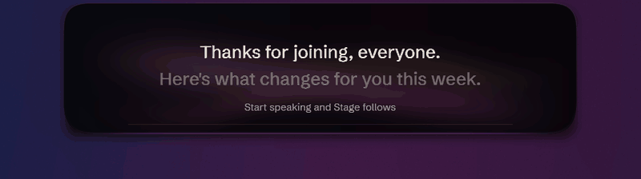
</p>

<p align="center"><b>The island sits next to your webcam, so it becomes your studio when you present or record.</b></p>

- **Your script under the lens.** Three calm lines in warm off-white, set short so your eyes barely leave the camera, with one hairline for progress.
- **Paced by your voice.** It moves on while you speak and waits when you pause. No speech recognition, no extra memory.
- **A ring light your call never sees.** A warm glow around the screen's edge lights your face in a dark room, hidden from screen shares and recordings.
- **Their words, quietly.** The other person's latest line appears small under your script, from Windows' own Live Captions.
- **Bring the script your way.** Paste it, type it, drop it in, or say **"stage from clipboard"**. Mirror and Record sit one click away.

<br>

<a name="hover"></a>
<p align="center"><picture><source media="(prefers-color-scheme: dark)" srcset="docs/images/type/hover-dark.svg"></picture></p>

**Hold <kbd>Left Alt</kbd> and point at words** anywhere on screen. A small bubble translates a foreign word, converts a price or a time zone, or explains a term, without a click. The words are read on your PC with Windows' own OCR; only a translation or a meaning sends those few words to Google. Turn it off in Settings › Voice & search.

<br>

<a name="the-floating-island"></a>
<p align="center"><picture><source media="(prefers-color-scheme: dark)" srcset="docs/images/type/the-floating-island-dark.svg"></picture></p>

<p align="center">
  
</p>

The notch doesn't hang from the edge of your screen. It **floats** a few pixels below it, a pill of dark frosted glass.

- **Light like water.** Soft waves drift inside the glass in the colours of what you're playing, and hold still (costing nothing) when nothing is happening.
- **One liquid surface.** When there's something to press, a round button beads out of the island's end through a smooth, water-drop neck.
- **A rim that breathes.** A thin line of light along the bottom edge tells you the state without opening anything: **red** while your mic is live, **green** before a meeting, **blue** in focus, your **song's colour** with music.
- **The time, always.** It sits at the right end of the island whatever is happening (a song, a call, a timer, a recording) and, with the date, at the top of the open island.
- **Fake glass, real calm.** The frosted look is a tiny pre-blurred copy of your wallpaper (about 26 KB), remade only when your wallpaper changes. No live blur, no busy graphics card.

<p align="center">
  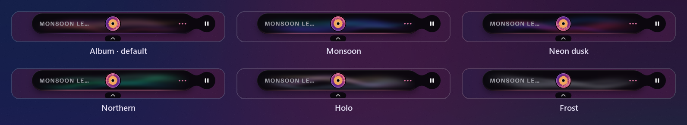
</p>

<p align="center"><sub><b>Six palettes.</b> <b>Album</b> (the default) takes its colours from the cover of what's playing. Pick another in Settings › Notch.</sub></p>

<br>

<a name="one-calm-screen"></a>
<p align="center"><picture><source media="(prefers-color-scheme: dark)" srcset="docs/images/type/one-calm-screen-dark.svg"></picture></p>

<p align="center">
  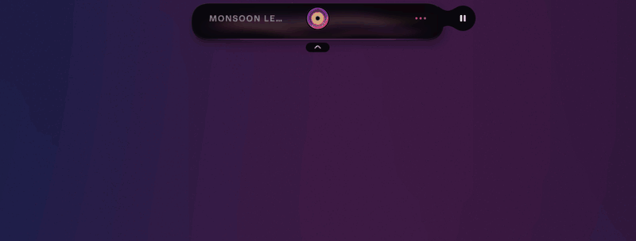
</p>

Rest the pointer on the island, or click it, and it opens into **one screen**: the time and date, one sentence about right now, one big moment (your song, your call, your focus time, your next meeting with *Join*), three numbers in light type, and **six tools that change with what you're doing**.

**Slide right** (swipe, the dots or the arrows) for **everything Shammy does**: the features you use most as big tiles, then every other one A to Z. Nothing to search for.

#### Tap the date: your month, right beside it

<p align="center">
  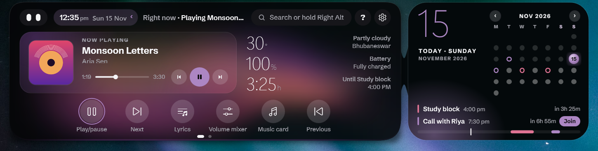
</p>

Tap the time and date at the top of the open island and **the month opens on its right**, a slab of the same glass and the island's own height, joined by a short liquid neck. The island glides left to make room, so the month sits under your pointer in one smooth move.

- **The month as dots.** Rest on a day and it opens into a numbered circle; today glows in your palette's colour; days with events are ringed in their colour; days gone by dim.
- **The day at a glance.** A big light number for the chosen day, its events with *in 3h 25m* and **Join** on today's meeting, and the day as a thin line with a "now" needle.
- **Any day, any month.** Tap a day, scroll, or use the arrows. Events come from your Google Calendar (from this week to the end of next month); titles show as *Busy* while you share your screen.

#### Alarms that ring in the sky outside

<p align="center">
  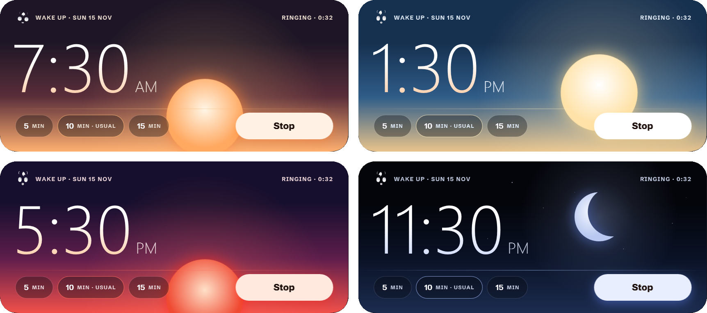
</p>

An alarm opens the island into **the sky of the hour it rings**: a sunrise before 9, a bright day until 4, a sunset until 7, and night with the moon after that. The sky comes up over its first 30 seconds, the sun rising behind a big light time, and one tap on **Stop** ends it.

- **Light before sound.** For the two minutes before an alarm, the bottom edge of the resting island warms in that sky's colour.
- **Your morning, after Stop.** Stop a morning alarm and a short card says good morning with the date, the weather, your first event and today's reminders.
- **Snoozed and missed.** A snoozed alarm's sun climbs a little arc as the snooze runs out; a missed one shows in the island, and tapping a missed morning alarm opens your morning.
- **Calm stays calm.** With Calm motion on, the sky is simply there, and the island doesn't glow ahead of time.

<a name="your-phone"></a>
#### Your phone, in the same family

**Shammy Island** (Android 11 and later) draws the same pet around your phone's camera and links it to Shammy over your own Wi-Fi, or your phone's hotspot. Click the **phone button** at the top of the open island to pair, or to get the app with a QR code: straight from this laptop, or from GitHub.

- **One list of notifications.** Your phone's and your laptop's together, newest first, each with a little phone or laptop beside it and **All · Phone · Laptop** to narrow it down. Dismiss one on either device and it's gone from both. Type `reply on my way` to answer the phone's latest message from your keyboard. Each side has its own soft chime, so you can tell by ear where it came from.
- **Laptop notifications on the phone** drop a short two-line card from the notch, then wait in the phone's list.
- **Your phone as a remote.** What's playing on your laptop (with its cover), play, skip and volume; your timers, calls and downloads with their own button; **Lock** and **Sleep** (tap twice); and Claude Code's **Allow / Deny**, from an unlocked phone only.
- **It keeps itself up to date.** Each Shammy update brings the newest Shammy Island and hands it to your phone over the link; the phone installs it only if it's signed by Shammy Island's own key (Android asks the first time).
- **Paired like Bluetooth.** Both screens show the same 6 digits and you confirm on both; after that, a small green dot on the island says your phone is online.

<table>
<tr>
<td width="50%">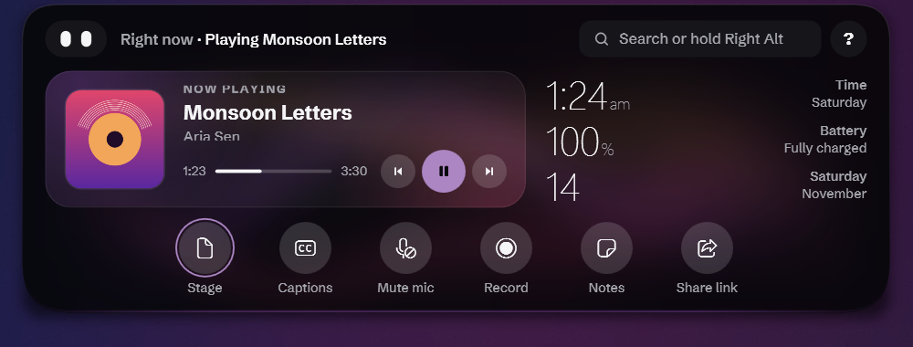<p align="center"><sub><b>In a call:</b> Stage, Captions, Mute mic, Record, Notes, Share link</sub></p></td>
<td width="50%">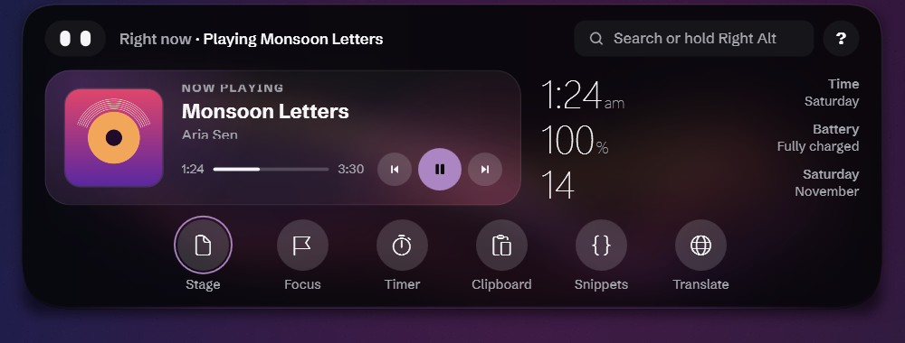<p align="center"><sub><b>Writing or coding:</b> Prompter, Focus, Timer, Clipboard, Snippets, Translate</sub></p></td>
</tr>
</table>

<br>

<a name="the-dial"></a>
<p align="center"><picture><source media="(prefers-color-scheme: dark)" srcset="docs/images/type/the-dial-dark.svg"></picture></p>

<table>
<tr>
<td width="45%" align="center">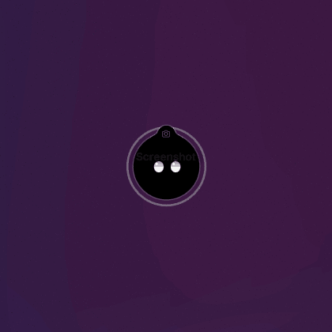</td>
<td width="55%" valign="middle">

**Hold the middle mouse button.** The dial blooms right where your pointer is, like a drop landing on water. Six tools bead out around it.

- **Scroll to turn it**, or just move toward the tool you want.
- **Let go to choose.** Let go over the centre (or press <kbd>Esc</kbd>) to cancel.
- **It knows the moment.** In a call it offers Stage and captions; with music, the player; in an editor, your writing tools.
- A quick middle click still reaches your apps, and the dial stays out of the way over fullscreen games and videos.

</td>
</tr>
</table>

<p align="center">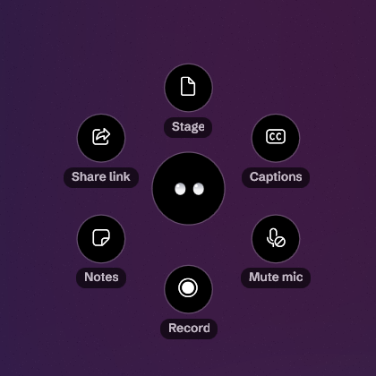</p>

<br>

<a name="every-card"></a>
<p align="center"><picture><source media="(prefers-color-scheme: dark)" srcset="docs/images/type/every-card-dark.svg"></picture></p>

<p align="center">
  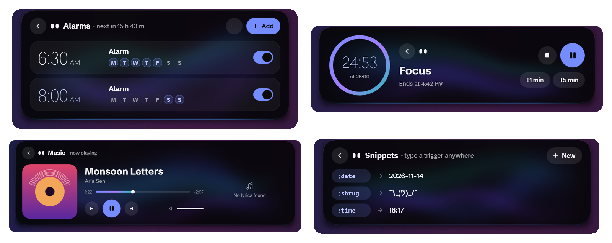
</p>

Open any card (Alarms, Timer, Clipboard, Notes, Weather, System, Health, Calendar, Laptop, Volume, Music, Settings and the rest) and **the island shapes itself around it**. Every card has one header, light numbers and bold words on glass, and colour only from the island's palette, so under **Album** your cards take the colours of the song you're playing.

<br>

<a name="light-by-design"></a>
<p align="center"><picture><source media="(prefers-color-scheme: dark)" srcset="docs/images/type/light-by-design-dark.svg"></picture></p>

| | Before | Now |
|---|---|---|
| Memory while idle (Task Manager) | several hundred MB | **about 90 MB** |
| Browser processes while idle | 6 | **0** (results open a browser only when they show) |
| Voice model in memory | always | **never**, unless you're offline and speak |
| Graphics work at rest | live blur and shadows | **none**: everything rests still |
| Installer | 133 MB | **104 MB** |

<br>

<a name="everything-else"></a>
<p align="center"><picture><source media="(prefers-color-scheme: dark)" srcset="docs/images/type/everything-else-dark.svg"></picture></p>

| | |
|---|---|
| 🗣️ **Talk to it** | Hold <kbd>Right Alt</kbd> and say it your way, in English or Hinglish: *"screenshot le lo"*, *"gaana band karo"*, *"battery kitni hai"*. Two things at once work too. Not sure what you meant? It offers **Did you mean** choices instead of guessing. |
| ⌨️ **Type anything** | Tap <kbd>Right Alt</kbd> for the palette: apps, files, settings, music and commands rank as you type. |
| 💻 **Your laptop, in one card** | Wi-Fi, Bluetooth, power mode, keep awake, mute mic, **Quiet**, **night light**, lock, sleep, restart or shut down (they ask first). |
| 🔢 **Codes at a glance** | A one-time code shows big in the island with **Copy**: copied privately, cleared after a minute, hidden while you share, never logged. |
| 🌅 **Morning brief** | Weather, meetings, reminders and a low battery in one line on the first unlock of the day. |
| 🎯 **Focus in one click** | It pauses Windows' focus with you and tells you afterwards what waited: *3 messages waited · WhatsApp, Gmail*. |
| 🩺 **Health** | Drive space, a careful cleanup (each step asks first), and a daily check of battery wear, startup apps and updates. |
| 🎵 **Music** | *"play …"* in YouTube Music or Spotify, synced lyrics, drag the song line to seek, scroll for volume, swipe to skip. |
| 📱 **To phone** | Files, links and text to your phone over your own Wi-Fi; with nothing chosen, it asks what to send. |
| 🏝️ **[Shammy Island](#your-phone)** | Your Android phone, linked: one notification list for both, your phone as a remote, Claude Code answered from your pocket. |
| ⏱️ **Timers, alarms, reminders** | Live countdowns, alarms that ring through fullscreen in the sky of their hour, and reminders in plain words: *"remind me at 6pm to call mom"*. |
| 📅 **Calendar** | Your Google Calendar from its secret address (no sign-in), *Join* five minutes before, and the month beside the island when you tap the date. |
| 📋 **Clipboard, shelf, snippets** | Clipboard history with search, a file shelf you drop onto, and snippets that expand in any app. |
| 🔔 **Notifications** | Other apps' notifications, calmly, with message text hidden while you share your screen. |
| 🤖 **Claude Code** | Coding-agent sessions in the island, with Allow and Deny. |
| 🎥 **Record and caption** | Record your screen to MP4, and live captions for anything your PC plays. |
| ⚙️ **Settings you can search** | A search box that finds any setting; the palette flips switches right in the list. |
| 🐾 **Shammy the pet** | A pair of eyes, or a cat with ears and a purr, that reacts to what you're doing. |

<br>

<a name="install"></a>
<p align="center"><picture><source media="(prefers-color-scheme: dark)" srcset="docs/images/type/install-dark.svg"></picture></p>

1. Download **`Shammy-Setup.exe`** from the [latest release](https://github.com/Roushan-2104/Shammy-Notch-For-Windows/releases/latest) and run it. It installs for your account only, with no admin prompt; .NET is included.
2. On first run, Shammy asks once whether it should **start with Windows**. The welcome tour follows.

- **Updates are automatic**, usually just a few MB, with a short note about what's new.
- **No installer?** `Shammy-Portable.zip` runs from any folder and updates itself the same way.
- **Voice:** with your own Gnani key (Settings › Voice & search), voice commands and dictation are heard online, in English, Hinglish and Hindi. Without a key, a small English model (about 148 MB, downloaded the first time it's needed) hears voice commands on your PC.

<details>
<summary><b>Requirements and first-run notes</b></summary>

- **Windows:** 10 (2004+) or 11. **Live captions** need Windows 11 22H2 or newer.
- **WebView2 Runtime** for search results. It comes with Windows 11 and current Edge; if it's missing, the island links to Microsoft's installer.
- **SmartScreen:** the build isn't code-signed yet, so SmartScreen may ask you to confirm the first run.
- **Uninstall** from Settings › Apps. Your settings and data in `%LOCALAPPDATA%\Shammy` are kept.

</details>

<a name="keys"></a>
<p align="center"><picture><source media="(prefers-color-scheme: dark)" srcset="docs/images/type/keys-dark.svg"></picture></p>

| | Key | What happens |
|:-:|---|---|
| ⭕ | <kbd>Copilot</kbd>, or hold <kbd>Right Ctrl</kbd> | **Circle.** The screen freezes; circle anything to search it. |
| 🎙️ | **Hold** <kbd>Ctrl</kbd> + <kbd>Win</kbd> | **Dictate.** Talk; let go and it's typed where your cursor is. |
| 🗣️ | **Hold** <kbd>Right Alt</kbd> | **Talk.** Say a command or ask a question; let go and it runs. |
| ⌨️ | **Tap** <kbd>Right Alt</kbd> | **Type.** The palette drops out of the island. |
| 👆 | **Hold** <kbd>Left Alt</kbd> and point | **Understand.** A bubble translates, converts or explains. |
| 🫧 | **Hold** the middle mouse button | **Dial.** It blooms at your pointer; scroll to turn, let go to choose. |

Something of yours under the island? Click the **small tab under it** and it slides away for a few seconds. Click the open island once and <kbd>Tab</kbd>, the arrow keys, <kbd>Enter</kbd> and <kbd>Esc</kbd> work in it.

> On layouts where Right Alt is AltGr (English India, German, French…), Right Alt on its own is the talk key, and AltGr + a key still types (₹, €, @). Right Ctrl only counts when held on its own, and Ctrl + Win shortcuts (Ctrl+Win+D, Ctrl+Win+arrows) still work.

<a name="say-it-or-type-it"></a>
<p align="center"><picture><source media="(prefers-color-scheme: dark)" srcset="docs/images/type/say-it-or-type-it-dark.svg"></picture></p>

| Say or type | What happens |
|---|---|
| `play kaahe mose` · `kesariya bajao` · `play tum hi ho on spotify` · `pause` · `next` | Plays in YouTube Music (or Spotify) · media controls |
| `stage` · `stage from clipboard` · `close stage` | Your script under the camera |
| `turn off wifi` · `wifi band karo` · `bluetooth on` · `performance mode` · `night light on` · `quiet for an hour` | The Laptop card's switches, by voice |
| `health` · `clean up my pc` · `disk space` | The Health card |
| `good morning` · `morning brief` | Your morning brief |
| `timer 25m tea` · `stopwatch` · `pomodoro` · `focus 45m` | A live countdown in the island |
| `remind me at 6pm to call mom` · `kal subah 7 baje ka alarm laga do` · `note: buy milk` | Reminders, alarms and notes |
| `5 ft in cm` · `100 usd to inr` · `1.2 lakh in dollars` · `5pm ist in pst` · `time in tokyo` | Instant answers |
| `translate good morning to hindi` | Google Translate, in the island |
| `why is the sky blue` · `capital of japan` · `search best pizza near me` | A short answer from Google AI Mode (said aloud when you asked by voice) · *"search …"* opens the results |
| `calendar` · `what's next` | Your next meeting · the Calendar card |
| `open spotify` · `open github.com` · `open downloads` | App, site or folder launcher |
| `record my screen` · `live captions` · `captions off` | Recording · captions for what your PC plays |
| `take a screenshot and send it to my phone` | Two things, one after the other |
| `help` · `what can you do` · `how do I record my screen` | The guide, with a finder that takes your own words |
| `volume 50` · `brightness to 70%` · `mute mic` · `clipboard` · `laptop` | Levels, the mic, the Clipboard and Laptop cards |

<a name="privacy"></a>
<p align="center"><picture><source media="(prefers-color-scheme: dark)" srcset="docs/images/type/privacy-dark.svg"></picture></p>

- **Your voice:** with your Gnani key, a command's recording goes to Gnani while you hold the talk key; the key is encrypted on your PC. Without a key or offline, it's heard on your PC by the small offline model. Text on screen is read with Windows' own OCR.
- **Dictation:** the recording goes to Gnani only while you hold the dictation key (for the live words, then once more for the final words); it's never saved. The words are pasted through a private copy that skips clipboard history, your clipboard is put back, and the log only ever counts words. It's off in password boxes and hidden to "Dictating…" while you share your screen.
- **What leaves your PC:**
  - searches go to Google only when you ask; the island shows "Sent to Google" whenever an image goes to Lens;
  - a circled phone number, email, link, date, address, sum, colour, time zone, flight, tracking number, PNR, UPI ID or vehicle number is read on your PC and goes nowhere; a circled name or term (one to four words) is looked up on Wikipedia, and only those words are sent;
  - a question, an "explain" or a translation goes to Google (AI Mode or Translate) only when you ask, with only those words; a picture goes to Lens only when you circle it;
  - for an IFSC or PIN code, only the code is sent to a free public lookup (Razorpay's IFSC service, India Post);
  - **Open in ChatGPT** opens chatgpt.com in your browser only when you tap it;
  - a spoken answer goes to Gnani to be voiced, only when you asked by voice and a key is saved;
  - "weather in &lt;city&gt;" sends only that city name to Open-Meteo (no account, no key);
  - the calendar is read only from Google, at the secret address you pasted.
- **Captions, recordings and Stage:** captions come from Windows' Live Captions on your PC; recordings go only to your Videos folder; Stage and its ring light are hidden from screen shares and recordings.
- **One-time codes:** copied privately (no clipboard history, no cloud clipboard), cleared after a minute, hidden while you share your screen, and never written to the log.
- **Sharing your screen:** while you share your whole screen or record it, message text, meeting titles, reminders, notes and clipboard text are hidden.
- **Camera:** the mirror's camera runs only while the mirror is open on screen.
- **Your data:** clipboard history, notes, snippets and your calendar's address are encrypted with Windows DPAPI under your account; unpinned clipboard items are forgotten after 24 hours.
- **Logs** never contain what you said, searched, dictated or copied, and are kept for 3 days.
- **Phone transfers** stay on your local network, behind a random one-time link; received programs are renamed `.blocked`.
- **Claude Code** talks to Shammy only on your own PC, through a local address with a random token.
- **Your phone (Shammy Island)** talks only to the laptop it paired with: end-to-end encrypted with fresh keys for every connection, each device's identity checked on every reconnect, and no server in between. Pairing needs the same 6 digits confirmed on both screens. Nothing listens on the network unless a phone is paired or you've opened the 2-minute pairing window. Anything that acts on the laptop (Claude's Allow, Lock, Sleep) needs your phone unlocked. Hiding Android's own banners is optional, and **Restore all** puts every app back.

<details>
<summary><b>Known limits</b></summary>

- **Google robot check.** On shared or mobile connections Google sometimes shows "I'm not a robot" in the results card. Tick it once and the browser profile remembers it.
- **Lens** uses the same upload endpoint as lens.google.com's own upload button. It isn't a public API, so it could change.
- **Dictation into an app running as administrator** can't be typed (Windows doesn't let other apps send it keys). "In Hindi" said as the very last words of a sentence can't be told apart from a sentence that ends that way.
- **Brightness keys:** Windows' own brightness pop-up can't be suppressed, because the firmware handles those keys.
- **Notifications:** clicking one opens the app, not the exact chat.
- **Exclusive-fullscreen games** can draw over a timer or alarm that breaks through fullscreen; you still hear its chime.
- **The Copilot key** replaces Windows' Copilot/Search action while Shammy runs.
- **Shammy Island** is installed from the QR code (Android asks you to allow installing it once); it isn't on the Play Store. Linking from anywhere (outside your Wi-Fi) needs a small relay you host yourself (`tools/relay/relay.py`). The first time Shammy listens for your phone, Windows asks once to allow it on your network.

</details>

<a name="build"></a>
<p align="center"><picture><source media="(prefers-color-scheme: dark)" srcset="docs/images/type/build-dark.svg"></picture></p>

```bash
dotnet test tests/Shammy.Core.Tests
dotnet run --project src/Shammy.App
```

You need Windows 10 (2004+) or 11, the .NET 8 SDK, and the WebView2 Runtime.

<details>
<summary><b>Releasing an update</b></summary>

1. Bump `<Version>` in `Directory.Build.props` and add the version's lines to `WhatsNew.cs`.
2. Commit and push.
3. Run:

```bash
powershell -File scripts/release.ps1 -Publish
```

The script builds a self-contained release, packages it with [Velopack](https://velopack.io) (with a small delta from the previous release), and uploads Setup, the portable zip and the update packages to a GitHub release using your `gh` login. Without `-Publish` it only builds into `artifacts/releases`.

</details>

<details>
<summary><b>How it's put together</b></summary>

```
src/Shammy.Core      pure logic, unit tested: springs, activity priority, parsers, the island's look and
                     palettes, the dial's maths, Stage's pacing, dictation's clean-up, health and cleanup rules
src/Shammy.App       WPF app
  Shell/             the floating island: state machine, springs, shape, fake glass, waves, rim light
  Views/             the pet, the open island's Now screen, cards, search bar, results
  Search/            hotkeys, screen freeze, OCR, microphone, dictation, online voice with an offline backup
  Modules/           self-contained features (Stage, the dial, Laptop, Health, music, calendar, focus,
                     codes, morning brief, clipboard, mirror, captions, launcher, snippets, …)
  Playback/          media sessions, audio visualizer
  SystemInfo/        volume, brightness, battery, Bluetooth, downloads
  Notifications/     other apps' notifications via the Windows listener
  Interop/           Win32: keyboard and mouse hooks, window styles, capture
tests/               over 4,400 xUnit tests for Shammy.Core
```

Each feature is a module in `src/Shammy.App/Modules/`; its README explains how to add your own.

</details>

## Credits

- **Hero wallpaper:** aurora photo by [Condor Wei](https://unsplash.com/@cwcanchn) on [Unsplash](https://unsplash.com/photos/aurora-borealis-in-starry-night-sky-oMcTmNHclZI), used under the [Unsplash License](https://unsplash.com/license) ([the copy used here](docs/images/wallpaper.jpg)).
- Third-party models and libraries are credited in [THIRD-PARTY-NOTICES.md](THIRD-PARTY-NOTICES.md).

## License

[MIT](LICENSE) © Roushan
